# Private lesson videos with Next.js, signed links and Terraform for AWS

**Typical request we see:** a small online course or membership site wants its lesson videos to play
only for logged-in students. Today the files sit behind plain links that anyone can copy and share,
and they want it on AWS, set up as code, with a deploy pipeline they can rerun.

This repo is an **open-source demo** of how I build that, for **Northwind Academy, a fictional school**.
It is not a client project. Everything below runs on your machine without an AWS account; the AWS
part is Terraform that is tested offline (see [Limits](#limits)).

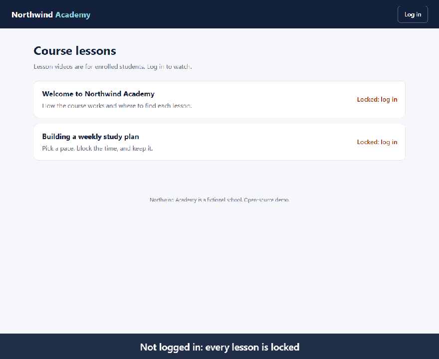

*Recorded by `npm run build && npm run record` against the app running locally, with an 8-second link lifetime so the
expiry fits in the GIF. The two "Request to the video link" panels show real responses from the local
edge server; the script fetches the link and displays the status and body.*

## What it shows

- **Login and roles** with Auth.js (NextAuth, credentials provider): `student` and `admin`. Logged-out
  visitors see lesson titles only.
- **Videos only play through a short-lived signed URL.** The app signs a CloudFront URL (canned
  policy) for one video at a time. Without a signature, with a signature for another file, or after
  the expiry time, the answer is **403**.
- **The same signing code locally and on AWS.** On AWS, CloudFront verifies the signature against a
  key group and reads the private S3 bucket through Origin Access Control. Locally, a small edge
  server (`edge/server.ts`) verifies the signature the same way CloudFront documents it, and serves
  files from a folder.
- **Admin uploads** (MP4 or WebM, checked by content, not by file name) are stored under a random
  name as **drafts**. Students cannot list, open or get a link for a draft until an admin publishes it.
- **Terraform for AWS** (`infra/`): private S3, CloudFront with OAC and a key group, ECS Fargate behind
  an Application Load Balancer that only accepts CloudFront, secrets in SSM Parameter Store, and a
  GitHub OIDC role for deploys. Checked by `terraform test` with a **mocked** AWS provider.
- **GitHub Actions**: one workflow runs the app tests and the infrastructure checks; a separate
  deploy workflow runs only when started by hand and only with the AWS role configured.

| Logged out | Student watching | Same link after it expires |
|---|---|---|
| 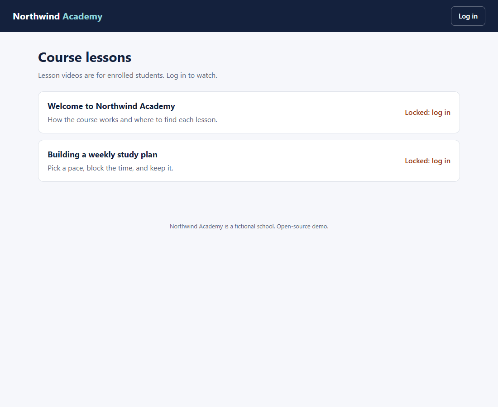 | 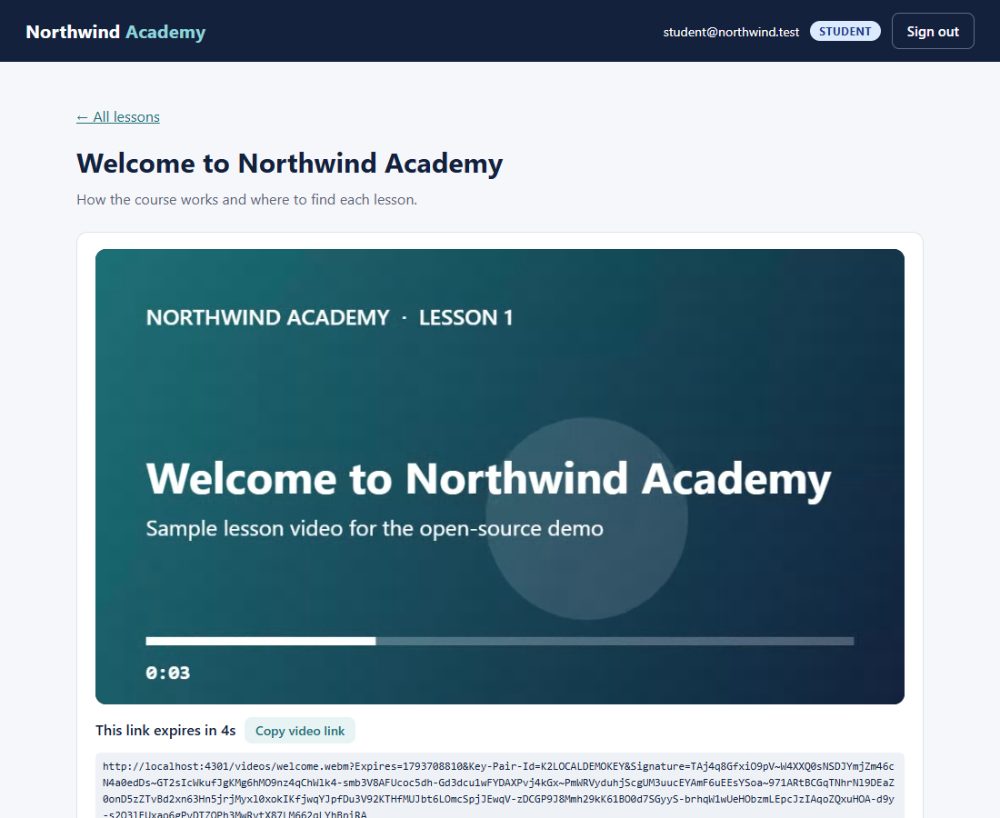 | 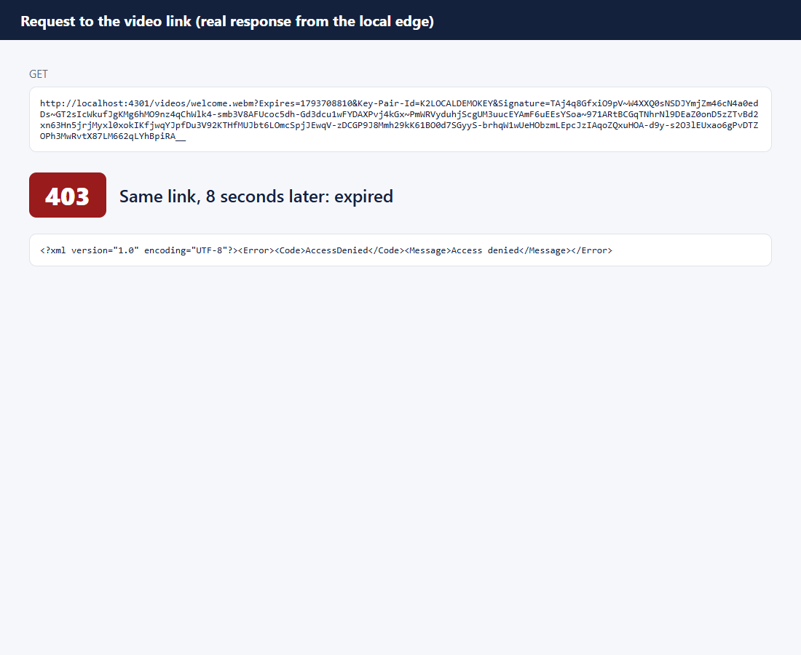 |

| Admin: drafts and upload | Student opening a draft |
|---|---|
| 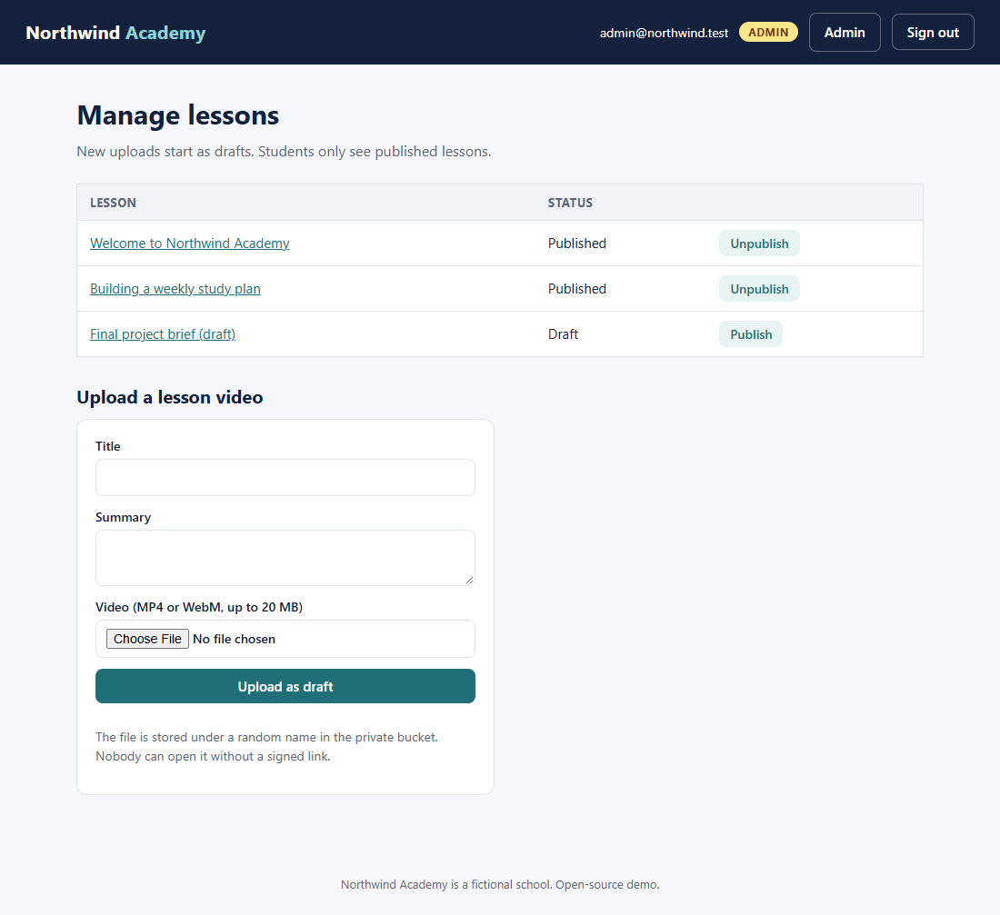 | 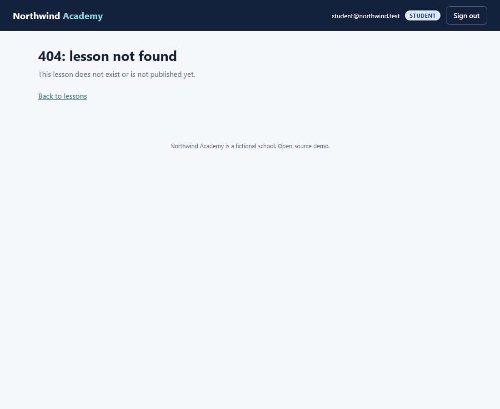 |

## Run it

Requirements: Node.js 20.9 or newer. No Docker, no AWS account, no API key.

```bash
npm install
npm run setup     # throwaway signing key pair, .env.local, sample videos into ./storage/data
npm run dev       # app on http://localhost:3000, local edge on http://localhost:4001
```

Log in as `student@northwind.test` / `northwind-student` or `admin@northwind.test` / `northwind-admin`
(local demo passwords, written to `.env.local` by `npm run setup`; on AWS they are random and kept in SSM).

The sample videos in `storage/seed/` were generated by `npm run videos` (a canvas animation recorded
in the browser). There is no stock footage or third-party content in the repo.

## How it works

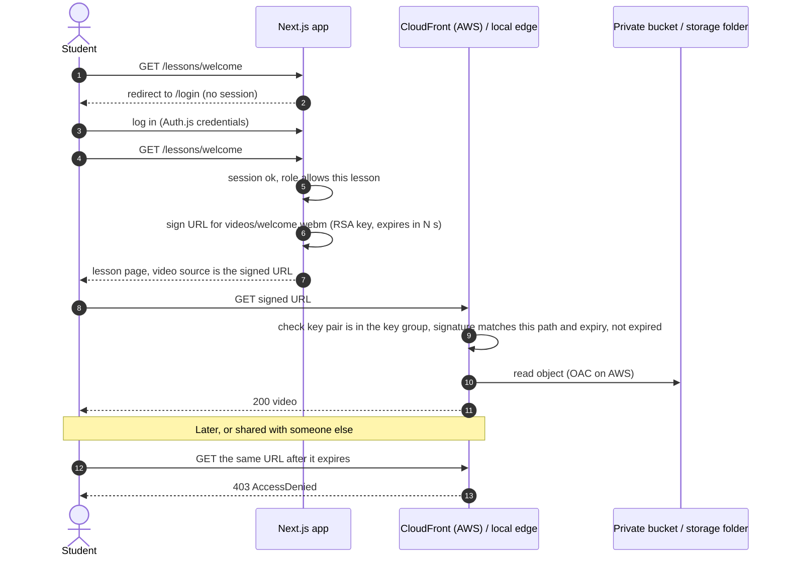

On AWS ([diagram](docs/architecture.svg)):

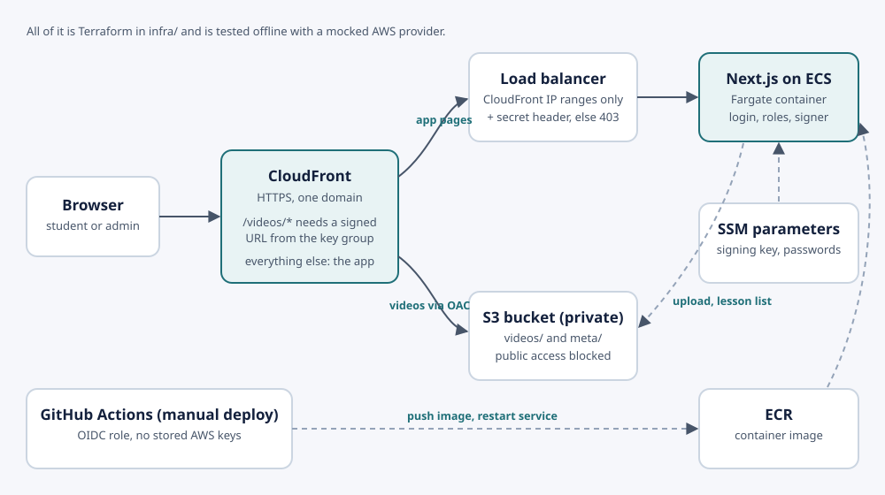

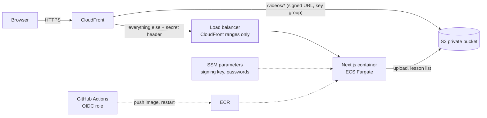

Code map:

| Path | What |
|---|---|
| `lib/video/signer.ts` | Builds the CloudFront signed URL with `@aws-sdk/cloudfront-signer` |
| `lib/edge/verify.ts` | Verifies a canned-policy signed URL the way CloudFront does (used by the local edge and the tests) |
| `edge/server.ts` | Local stand-in for CloudFront + private bucket: 403 unless the URL is signed and fresh |
| `lib/access.ts` | Who can see, open and manage which lesson (pure functions, unit-tested) |
| `lib/auth.ts`, `lib/users.ts` | Auth.js config, two demo accounts with passwords from the environment |
| `app/api/lessons/[id]/url` | Returns a fresh signed link; the player calls it if a link expires mid-lesson |
| `app/admin/` | Upload and publish, role checked inside each server action |
| `lib/storage/` | Local folder or S3 for videos and the lesson list |
| `infra/` | Terraform: network, bucket, CloudFront, ECS/ALB, SSM, GitHub OIDC, offline tests |

## Tests

```bash
npm test                                # unit tests (vitest)
npm run build && npm run test:e2e       # browser tests (Playwright) against the production build
terraform -chdir=infra init -backend=false
terraform -chdir=infra test             # Terraform tests with a mocked AWS provider, no account needed
```

`npm run test:e2e` uses Playwright's Chromium (`npx playwright install chromium` once). To use an
installed browser instead, set `PW_CHANNEL=msedge` or `PW_CHANNEL=chrome`.

What they check:

- **Signer and verifier (unit):** a key pair is generated in the test. A fresh link is accepted; it is
  refused at the expiry second, when reused on another video, when `Expires` is edited by hand, when
  signed by a key outside the key group, when a query parameter is added, and when the domain differs.
  One test checks the signature against the canned policy text from the CloudFront documentation with
  plain `crypto.verify`, so it does not depend on the local verifier.
- **Access rules and server actions (unit):** logged-out, student and admin cases; a student calling
  the upload or publish action directly gets "Admins only." and nothing is stored.
- **Uploads (unit):** a PNG renamed to `.webm`, an MP4 declared as WebM, oversize files and bad titles
  are refused; accepted files get a random object name.
- **End to end (Playwright, real browser):** logged out, the lesson redirects to login, the API returns
  401 and the raw video URL returns 403; a student's video actually plays (the test waits for
  `currentTime` to advance); the copied link returns 200, then 403 after it expires; a student gets 404
  for a draft and 403 on the admin page; an admin upload stays hidden from a student until published.
- **Terraform (mocked provider):** bucket fully private and readable only by this distribution under
  `videos/`; `/videos/*` requires the key group and HTTPS; the load balancer accepts only CloudFront's
  prefix list and returns 403 without the secret header; no password, auth secret or signing key in
  plain environment variables; the deploy role trusts one repository and one GitHub environment;
  invalid inputs are rejected.

Last local run:

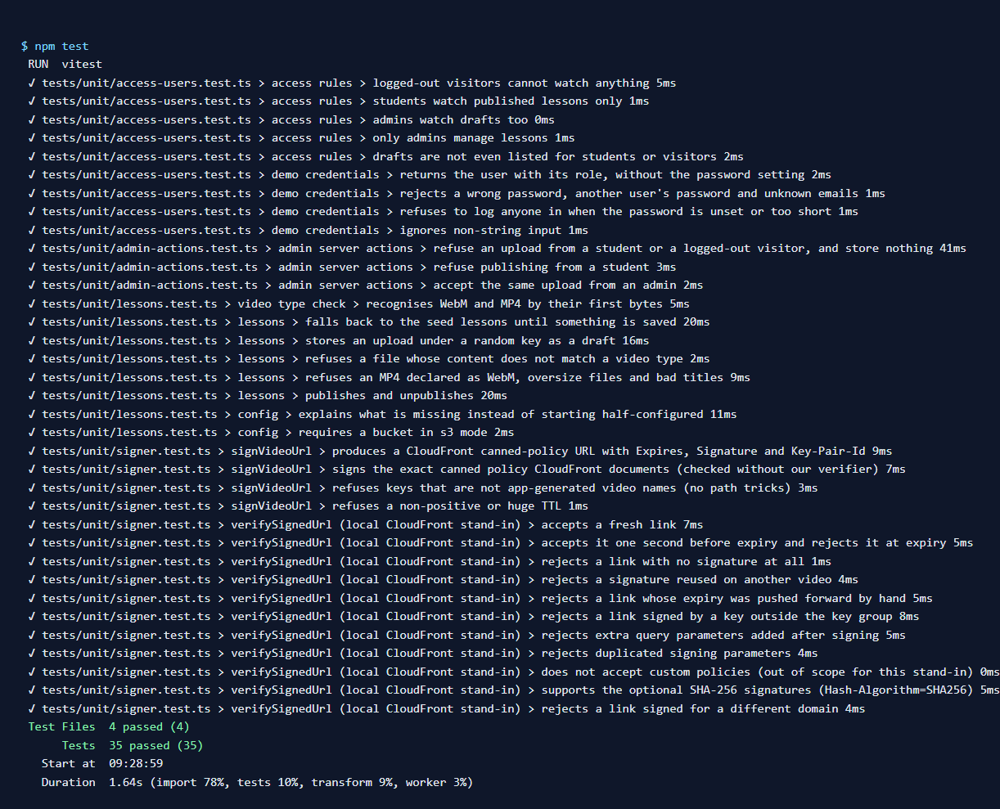
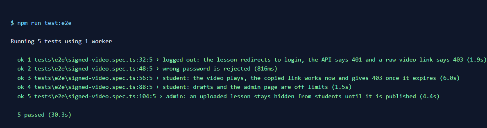
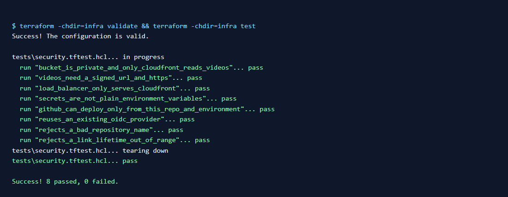

The GitHub Actions workflows (`.github/workflows/`) run the same commands plus `terraform fmt -check`,
`tflint` and a Docker build. They have not run on GitHub yet: this repository was built and tested
locally (see Limits).

## Deploy to your AWS account

Tested offline only (see Limits). Requirements: Terraform 1.7+, AWS CLI v2 logged in, Docker.

```bash
terraform -chdir=infra init
terraform -chdir=infra apply -var github_repository=<you>/<your-fork>
./scripts/push-image.sh      # build, push to ECR, restart the service, print the URL
```

Then read the demo passwords from SSM (`terraform -chdir=infra output demo_password_parameters` gives
the parameter names) and open the printed `https://<id>.cloudfront.net` URL. CloudFront can take a few
minutes to deploy on the first apply. Until step 3 pushes an image, the service cannot start its
container; that is expected.

To deploy from GitHub instead of your machine: create a GitHub environment named `aws-deploy`, add the
repository variables `AWS_DEPLOY_ROLE_ARN`, `AWS_REGION`, `ECR_REPOSITORY_URL`, `ECS_CLUSTER` and
`ECS_SERVICE` from the Terraform outputs, and run the "Deploy to AWS (manual)" workflow.

**Cost:** the load balancer and the Fargate task bill by the hour even with no visitors; CloudFront,
S3, ECR and SSM bill by use. Check the AWS Pricing Calculator for your region. When you are done:
`terraform -chdir=infra destroy -var github_repository=<you>/<your-fork>` (the bucket and the image
repository are set to be deleted with their contents).

## How it fails safely

- **No signature, no video.** The bucket blocks all public access; the bucket policy lets only this
  CloudFront distribution read, and only under `videos/`. The lesson list in `meta/` is never served.
- **Links die on their own.** A copied link stops working after `SIGNED_URL_TTL_SECONDS` (60 s locally,
  300 s by default on AWS). The player asks the app for a fresh link if one expires while the student
  is still watching, and the app checks the session again before signing. A logged-out tab cannot renew.
- **One link, one file.** The signature covers the full path and the expiry. Editing either one, or
  adding a query parameter, gives 403.
- **Drafts are not discoverable.** A student gets the same 404 for a draft as for a lesson that does not
  exist, from the page and from the link API.
- **Role checks live on the server.** Every page, the link API and each server action call
  `getCurrentUser()` and the rules in `lib/access.ts` themselves. Hiding the admin form is cosmetic.
- **Uploads are checked by content.** The first bytes must be MP4 or WebM and match the declared type;
  the object name is a random UUID, never the uploaded file name.
- **The app cannot be reached around CloudFront.** The load balancer only accepts CloudFront's
  origin-facing IP ranges and returns 403 without the secret header CloudFront adds.
- **Secrets stay out of the code and the task definition.** The signing key, the auth secret and the
  passwords are SSM SecureString parameters injected at container start. Locally, `.env.local` and the
  key pair are git-ignored.
- **The app cannot delete videos.** Its role can read and write `videos/` and `meta/`, nothing else.
- **Missing settings stop the app with a clear message** instead of starting half-configured.

## Design decisions and trade-offs

- **CloudFront signed URLs, not S3 presigned URLs.** The key stays with the app, the bucket stays
  private behind OAC, the files are cached at the edge, and links can be made short without signing
  each request to S3. Signed cookies would cover many files with one signature (useful for HLS
  streams); single-file MP4/WebM lessons do not need them.
- **A local edge instead of an S3 emulator.** The first plan was MinIO for local S3 presigned URLs. When
  this was built, the `minio/minio` images could not be pulled from Docker Hub or quay.io (checked with
  `docker manifest inspect`), and CloudFront has no local emulator. A short verifier of the documented
  canned-policy format keeps the local run on the same signing path as AWS and needs no Docker.
- **CloudFront in front of the app too.** One domain, HTTPS from the default `*.cloudfront.net`
  certificate, no certificate or DNS setup needed for a first deploy. With your own domain you would
  add an ACM certificate and HTTPS between CloudFront and the load balancer.
- **No database.** Two demo accounts come from the environment and the lesson list is one JSON object in
  the bucket. That keeps the AWS bill and the setup small; see Limits for what that costs.
- **Public subnets, no NAT gateway.** A NAT gateway bills by the hour. The container has a public IP to
  pull its image, and its security group accepts traffic only from the load balancer.
- **Mutable `latest` image tag.** Simple to redeploy with `--force-new-deployment`. A stricter setup
  would deploy an immutable tag or digest through a new task definition revision.
- **Next.js server actions for upload.** Short code, role-checked on the server. Files go through the
  app (limit 20 MB); large courses should upload straight to S3 with a presigned POST.

## Limits

- **Not deployed to a real AWS account in this repo.** `terraform validate` and `terraform test` ran
  with a mocked provider; no `terraform plan` or `apply` was run against AWS, so account quotas, IAM
  propagation timing and service-side validation were not exercised. The deploy steps above are written
  from the code, not from a recorded run.
- **The GitHub Actions workflows have not run on GitHub yet**, and `tflint` was not run locally (it is
  only in the CI workflow).
- The local edge implements canned-policy signed URLs only (`Expires`, `Signature`, `Key-Pair-Id`,
  optional `Hash-Algorithm=SHA256`). Custom policies, signed cookies, IP conditions and CloudFront's
  caching behaviour are not emulated.
- **Two fixed demo accounts**, passwords from environment variables. No sign-up, password reset, user
  table or login rate limit. A real school would use a user table or an identity provider (for example
  Cognito) and add rate limiting.
- **The lesson list is one JSON object**, so two admins saving at the same moment can overwrite each
  other. Fine for a demo; use a database table for real use.
- A student who is logged in can still download a video while the link is valid. Signed URLs limit
  sharing and hotlinking to the link lifetime; they are not DRM.
- The player's automatic link renewal (on a 403 mid-lesson) is not covered by a browser test; the
  link API it calls is.
- Uploads go through the app server and are capped at 20 MB. No transcoding, thumbnails or adaptive
  streaming (HLS).
- No custom domain or ACM certificate; traffic between CloudFront and the load balancer is HTTP inside
  AWS, protected by the IP allow-list and the secret header, not by TLS.
- Terraform state holds the generated passwords and the signing private key. Use an encrypted remote
  backend if more than one person runs it.
- Tested on Windows 11 with Node.js 22 and Edge (Playwright channel `msedge`), Terraform 1.11.

## Adapting this to your stack

- **Your videos:** upload through `/admin`, or put files in the bucket under `videos/` and add them to
  `meta/lessons.json`.
- **Your users:** replace `verifyCredentials` in `lib/users.ts` with your user table, or swap the
  credentials provider for an Auth.js OAuth/OIDC provider (Google, Microsoft Entra ID, Cognito). The
  role check stays in `lib/access.ts`.
- **Course enrollments:** extend `canViewLesson(user, lesson)` with a "user is enrolled in this course"
  lookup; the signer and CloudFront stay the same.
- **Your domain:** add `aliases` and an ACM certificate (in `us-east-1`) to the distribution in `infra/cdn.tf`.
- **Lower idle cost:** move the app from ECS + ALB to App Runner or Lambda; the bucket, CloudFront
  behaviour for `/videos/*` and the signer do not change.
- **Longer lessons:** raise `signed_url_ttl_seconds`, or switch to signed cookies if you move to HLS.

## License

MIT. See [LICENSE](LICENSE).
